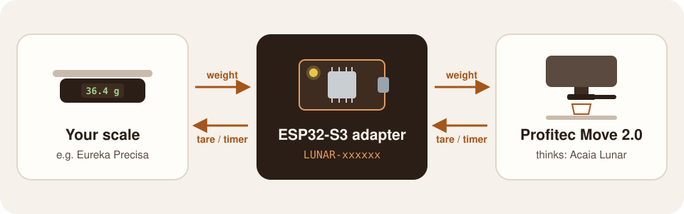

# Profitec-Move-2.0-BLE-Adapter-Acaia

[](https://github.com/oMtQB4/Profitec-Move-2.0-BLE-Adapter-Acaia/actions/workflows/ci.yml)

**[Bluetooth updater](https://omtqb4.github.io/Profitec-Move-2.0-BLE-Adapter-Acaia/)** ·
**[Configurator](https://omtqb4.github.io/Profitec-Move-2.0-BLE-Adapter-Acaia/config/)** ·
[Latest release](https://github.com/oMtQB4/Profitec-Move-2.0-BLE-Adapter-Acaia/releases/latest) ·
[Flash over USB](docs/flash-in-browser.md) · [Pair with the Move](docs/pair-with-move.md) ·
[Demo video](https://youtu.be/6yaJZlYYOEI)

Brew-by-weight on the **Profitec Move 2.0** with the Bluetooth scale you already have.

The Move 2.0 only does brew-by-weight in offline mode with Acaia scales. This firmware turns an
ESP32-S3 board into an adapter: it connects to your real scale and appears to the machine as an
Acaia Lunar (`LUNAR-xxxxxx`), relaying the weight one way and tare/timer commands the other.



- **Works end to end** with the Eureka Precisa: the shot stops at the target weight.
- **Tares by itself** when you put the cup down, like a Lunar in its espresso modes.
- **Updates over Bluetooth** from the browser, after a first installation over USB.
- **Configurable over Bluetooth** from the browser: auto-tare, taring the real scale, status LED.
- **Status LED** shows whether the scale and the machine (or another device) are connected.

**Demonstration:** [Profitec Move 2.0 - Offline mode with nearly every scale](https://youtu.be/6yaJZlYYOEI)

[](https://youtu.be/6yaJZlYYOEI)

## Supported scales

Only the **Eureka Precisa** has been tested with a real device. All other scales are
**integrated but not tested with a real device**: their drivers implement protocols documented
by open-source projects (see [Protocol references](#protocol-references)) and pass unit tests with
frames from those sources. Reports are welcome, ideally with a serial log
(`BRIDGE_LOG_SCAN_RESULTS` on).

| Scale | On the Move app list | Tare | Timer | Status |
|---|---|---|---|---|
| Eureka Precisa | yes | yes | yes | **tested on hardware** |
| Solo Barista | yes | yes | yes | integrated, not tested |
| Decent Scale (+ ButtsHaus clones) | yes | yes | yes | integrated, not tested |
| DiFluid Microbalance / Microbalance Ti | yes | yes | start/stop | integrated, not tested |
| Felicita Arc / Parallel / Incline | yes | yes | yes | integrated, not tested |
| Hiroia Jimmy | yes | yes | – | integrated, not tested |
| Skale II (Atomax) | yes | yes | yes | integrated, not tested |
| Varia AKU / AKU Mini | yes | yes | yes | integrated, not tested |
| Goat Story Gina | yes | software | – | integrated, not tested |
| Bookoo Themis Mini / Ultra | – | yes | yes | integrated, not tested |
| Timemore Black Mirror / Basic 3 / Dot | – | yes | yes | integrated, not tested |
| EspressiScale (DIY) | – | yes | yes | integrated, not tested |
| Smartchef | – | software | – | integrated, not tested |
| Blackcoffee.io | – | software | – | integrated, not tested |
| Futula Kitchen Scale 3 (LEFU CK811) | – | yes | – | integrated, not tested |
| Mantabrew WeighMaster 2.0 | – | yes | yes | integrated, not tested |
| WeighMyBru (DIY) | – | yes | yes | integrated, not tested |
| DIY mpy-coffee / coffee-scale (beeb) | – | software | – | integrated, not tested |

"On the Move app list": Profitec lists the scale as compatible with the Move 2.0 in app mode.
"software" tare: the scale takes no tare command, so the adapter zeroes the weight itself, which
is all the machine needs.

**Not supported:** Ikape scale and Brewista X (on the Move app list, but no public Bluetooth
protocol; a capture of the vendor app's traffic would be needed). Acaia scales need no adapter.

## Getting started

You need:

- An **ESP32-S3 board**, e.g. this [ESP32-S3-DevKitC-1 N16R8](https://amzn.eu/d/075jnXAs)
  (any ESP32-S3 works; all have at least 4 MB flash), and a
  **USB data cable**. On boards with two USB-C ports use the one labelled **USB**, not **COM/UART**.
- A supported scale, the **Make Coffee Yours** app (once, for pairing) and, for the first
  installation, a desktop computer with Chrome or Edge.

### 1. First installation over USB

Flashed once in the browser with Espressif's online tool, no installation needed
(step by step with troubleshooting: [docs/flash-in-browser.md](docs/flash-in-browser.md)):

1. Download `acaia-bridge-esp32s3-vX.Y.Z-to_flash_via_usb.bin` from the
   [latest release](https://github.com/oMtQB4/Profitec-Move-2.0-BLE-Adapter-Acaia/releases/latest)
   and plug in the board.
2. Open **[ESP Tool](https://espressif.github.io/esptool-js/)** in Chrome or Edge, set *Baudrate*
   `460800`, click **Connect** and pick the board.
3. Change *Flash Address* from the pre-filled `0x1000` to **`0x0`** and choose the downloaded file.
4. Click **Program**, wait for 100 %, click **Disconnect** and press **RST** on the board.

The LED now blinks red until the scale is connected. If the board isn't found, hold **BOOT**,
press and release **RST**, release **BOOT** and connect again. Coming from 1.0.x: 1.1.0 changed
the flash layout, so tick *Erase all* once.

### 2. Updates over Bluetooth

From 1.1.0 on, updates need no cable ([guide](docs/update-over-bluetooth.md)):

1. Hold the adapter's **BOOT** button for 3 s until the LED is steady purple (update mode).
2. Open the **[Bluetooth updater](https://omtqb4.github.io/Profitec-Move-2.0-BLE-Adapter-Acaia/)**
   in Chrome or Edge (Windows, macOS, Linux, Android) or in Bluefy on iPhone/iPad.
3. **Connect**, then **Install**. It takes about half a minute; the adapter restarts by itself.

A failed or interrupted update leaves the running firmware untouched, and a new firmware that
doesn't start properly is rolled back. In update mode the adapter advertises as
`AcaiaBridge-xxxxxx` and the bridge is off; afterwards it is `LUNAR-xxxxxx` again.

### 3. Pair with the Move 2.0

Once, in the Make Coffee Yours app ([guide with troubleshooting](docs/pair-with-move.md)):

1. Switch the scale on and wait until the adapter's LED turns **yellow**.
2. In the app, connect the machine, then the scale `LUNAR-xxxxxx`.
3. Settings → turn **Offline mode** (*Offline-Modus*) on, or off and on again → **Save** (*Speichern*).
4. Close the app or switch off the phone's Bluetooth: the adapter accepts one connection at a
   time, and a connected phone hides it from the machine.

The app identifies the scale by its serial number, which the adapter reports as its Bluetooth
address (e.g. `28372F80E382`). Pair again only after changing the identity: another ESP32 board
or a different `BRIDGE_NAME_PREFIX`. Updates keep the pairing. If the phone saw an older firmware,
switch its Bluetooth off and on once so iOS refreshes its cache.

### 4. Brewing

1. Switch the scale on; the LED turns yellow.
2. Put the cup on the scale and wait a second: the adapter tares it.
3. Start the shot. A few seconds in, the machine connects (LED blue) and stops at its target weight.

The Move only listens to the weight: it sends no tare, timer or heartbeat, and it connects only
after the shot has started. That's why the adapter tares when the cup is put down. If the cup
wasn't tared, it zeroes the weight when the machine connects, so the cup never counts towards the
target.

### 5. Settings (optional)

The **[Configurator](https://omtqb4.github.io/Profitec-Move-2.0-BLE-Adapter-Acaia/config/)**
changes over Bluetooth ([guide](docs/configure-over-bluetooth.md)):

- **Auto-tare** on or off, and when: once the cup has settled (default), or when the machine connects.
- **Tare the real scale too** (default on): off zeroes only the weight sent to the machine; the
  scale's display keeps its own zero.
- **Status LED**: standard, only while something is connected, or off; brightness.

It also shows which machine the adapter has learned. The adapter recognises the Move by its
behaviour (it subscribes to the weight and never writes) and remembers its Bluetooth address, so
apps and the configurator don't trigger the machine's tare and light the LED green instead of blue.

### Status LED

| LED | Meaning |
|---|---|
| red, blinking | searching for the scale; the Lunar is hidden from the machine |
| yellow | scale connected; Lunar visible, waiting for the machine |
| blue | machine connected; weight is being relayed |
| green | another device connected (an app, the configurator) |
| purple | update mode: waiting for firmware, bridge off |
| purple, fast blinking | receiving firmware |

## Development

### Build

ESP-IDF **v5.4.4**. By default the Makefile uses a local install at `~/esp/esp-idf-v5.4.4`
(override with `IDF_DIR=...`).

```sh
make build           # firmware → build/
make test            # host unit tests (protocols, drivers, tare, update session)
make ota             # update package → build/acaia-bridge-esp32s3-vX.Y.Z-ota_update.bin
make updater         # Bluetooth updater at http://localhost:8000, offering that package
make configurator    # Bluetooth configurator at http://localhost:8001
make menuconfig      # "Acaia Bridge" menu for project options
make shell           # shell with the IDF environment loaded
```

Without a local install, add `DOCKER=1` to any target to use the official image
`espressif/idf:v5.4.4` (output goes to `build-docker/`).

### Flash and monitor

```sh
make flash                             # auto-detects /dev/cu.usbmodem*
make flash PORT=/dev/cu.usbmodem1101
make monitor                           # idf.py monitor; quit with Ctrl-]
make flash-monitor
```

With `DOCKER=1`, flashing runs on the host via [esptool](https://github.com/espressif/esptool)
(`uvx esptool`, or set `ESPTOOL=esptool`) and `monitor` uses `screen` (quit with Ctrl-A K),
because Docker Desktop on macOS cannot pass USB devices into containers. The firmware logs its
version at boot (`acaia-bridge X.Y.Z`).

A release image can also be flashed from the command line (`uvx` runs esptool via
[uv](https://docs.astral.sh/uv/); `PORT` is `/dev/cu.usbmodem*` on macOS, `/dev/ttyACM0` on Linux,
`COMx` on Windows; over 1.0.x run `erase-flash` first):

```sh
uvx esptool --chip esp32s3 -p PORT write-flash 0x0 acaia-bridge-esp32s3-vX.Y.Z-to_flash_via_usb.bin
```

### Configuration (`make menuconfig` → Acaia Bridge)

| Option | Default | Meaning |
|---|---|---|
| `BRIDGE_NAME_PREFIX` | `LUNAR-` | advertised name prefix, MAC suffix appended |
| `BRIDGE_ADVERTISE_WITHOUT_SCALE` | off | advertise even with no real scale, to test the machine side alone |
| `BRIDGE_AUTO_TARE_DEFAULT` | cup | default auto-tare: `_CUP` tare once a cup (≥ 20 g) is put down or taken off while the machine is not connected, else when the machine connects; `_CONNECT` only when the machine connects; `_OFF`. A reconnect within 10 s keeps the zero |
| `BRIDGE_TARE_SCALE` | on | default for also taring the real scale; off zeroes in software only |
| `BRIDGE_STATUS_LED` | on | status on an addressable RGB LED (WS2812) |
| `BRIDGE_STATUS_LED_GPIO` | 48 | LED pin (DevKitC-1 v1.0: 48, v1.1: 38) |
| `BRIDGE_STATUS_LED_BRIGHTNESS` | 24 | default brightness, 1–255 |
| `BRIDGE_LOG_SCAN_RESULTS` | off | log every named BLE device seen while scanning (find the name of a new scale) |
| `BRIDGE_LOG_ACAIA_FRAMES` | on | hex-log machine ↔ adapter frames |
| `BRIDGE_UPDATE_BUTTON` | on | hold a button for 3 s to enter (or leave) update mode |
| `BRIDGE_UPDATE_BUTTON_GPIO` | 0 | BOOT button on DevKit boards |
| `BRIDGE_UPDATE_POWER_CYCLES` | 3 | enter update mode after this many power-ons in a row, each shorter than 10 s (0 = off) |
| `BRIDGE_UPDATE_MODE_TIMEOUT_MIN` | 5 | leave update mode after this many minutes without an update |

Options marked "default" only apply until the [configurator](docs/configure-over-bluetooth.md)
changes the setting; from then on the value stored on the adapter wins.

Flash layout, bootloader rollback and BLE MTU are set in `sdkconfig.defaults` and `partitions.csv`.
`sdkconfig.defaults` only applies to a new `sdkconfig`: after pulling 1.1.0, run `make fullclean`
once (it also deletes `sdkconfig`; redo your menuconfig changes afterwards). `make ota` refuses to
package an app built with an older `sdkconfig`. New Kconfig options also need `idf.py reconfigure`.

### Architecture

```
main/
├── main.cpp                    composition root, app loop
├── bridge/
│   ├── Bridge                  mediator: scale readings → Acaia, Acaia commands → scale
│   ├── ClientIdentifier        tells the machine from apps and the configurator (pure, host-tested)
│   ├── TareController          when to zero and when to tare the real scale (pure, host-tested)
│   ├── AutoTare                cup placed / removed detection (pure, host-tested)
│   └── SoftwareTare            instant zero with hand-over to the scale's own tare
├── config/                     settings over Bluetooth
│   ├── ConfigProtocol          pure record format for settings and status (host-tested)
│   ├── ConfigService           NimBLE GATT service, applies writes on the app task
│   └── SettingsStore           settings and learned machine address in NVS
├── status/                     status LED: LedPattern (pure, host-tested) + StatusLed (WS2812)
├── ota/                        firmware update over BLE
│   ├── OtaProtocol, AppImage   pure wire format and image header check (host-tested)
│   ├── OtaSession              pure transfer state machine over a FlashTarget (host-tested)
│   ├── OtaService              NimBLE GATT service, queues writes for the app task
│   ├── EspFlashTarget          esp_ota_* into the inactive slot
│   ├── UpdateMode, Triggers    entering update mode: button, power-on sequence
│   └── AppValidity             confirms a new image or lets the bootloader roll back
├── acaia/
│   ├── AcaiaProtocol           pure frame encode/decode (host-tested)
│   └── AcaiaPeripheral         NimBLE GATT server posing as a Lunar
└── scale/
    ├── Driver.hpp              Driver (strategy), Listener (observer), Transport
    ├── DriverRegistry.hpp      factory: advertisement → driver
    ├── ScaleClient             NimBLE central: scan, connect, subscribe, feed driver
    └── drivers/                one class per scale model + Drivers.cpp registration
web/updater/                    Bluetooth updater page (Web Bluetooth, no build step)
web/configurator/               Bluetooth configurator page, deployed under config/
docs/                           user guides (USB flashing, Bluetooth updates, settings, pairing)
release/README.md               guide inside the release zip
partitions.csv                  flash layout, frozen since 1.1.0
```

- **Drivers know no BLE.** A driver declares its GATT profile and translates bytes.
  `ScaleClient` does scanning, connecting and subscribing for every driver, and drivers
  write through the `Transport` interface. Drivers are therefore tested on the host with
  a fake transport.
- **One app task.** NimBLE callbacks only queue events. `ScaleClient::poll()` and
  `Bridge::poll()` run on the app task, so drivers and the bridge never run concurrently.
- **Two boot modes.** Bridge mode runs the scale client and the emulated Lunar; update mode runs
  only the update service. Switching restarts the chip. The GATT table is the same in both.
- BLE: [esp-nimble-cpp](https://github.com/h2zero/esp-nimble-cpp) (C++ wrapper over NimBLE).

### Adding a scale

1. Create `main/scale/drivers/MyScale.{hpp,cpp}`. Most drivers decode without state and derive
   from `DecodingDriver`, which supplies `name()` and `onNotify()`:

   ```cpp
   class MyScale : public scale::DecodingDriver<MyScale> {
   public:
       static constexpr const char* kName = "My Scale";
       static bool matches(const scale::Advertisement& adv);              // name and/or payload (service UUIDs)
       static std::optional<scale::Reading> decode(std::span<const uint8_t> data); // 0.1 g

       const scale::GattProfile& profile() const override;          // service / notify / write (nullptr = no commands)
       bool send(scale::Command cmd, scale::Transport& t) override; // tare / timer; false if unsupported

   protected:
       void onConnected(scale::Transport& t) override;              // optional handshake
       void onTick(scale::Transport& t, uint32_t nowMs) override;   // optional heartbeat
   };
   ```

   Helpers: `schedule(delayMs, bytes)` and `sendTwice(transport, bytes)` for timed writes,
   `transport.read(uuid)` for reading a characteristic, `scale/Bytes.hpp` for byte order and
   checksums, `scale/NameMatch.hpp` for case-insensitive names, `advertisesService16/128()` in
   `scale/AdvertisingData.hpp`, `fromCentigrams()`/`fromGrams()` for other resolutions.
   Drivers must not include ESP-IDF headers, so they stay testable on the host.
2. Register it in `main/scale/drivers/Drivers.cpp` (`registry.add<MyScale>();`); order matters,
   the first matching driver wins.
3. Add tests with frames from the protocol source (see `test/test_drivers_*.cpp`) and a sample
   name in `test/test_driver_registry.cpp`. Driver files are globbed: run `make fullclean build`
   (or `idf.py reconfigure`) once after adding a file.

How the built-in drivers recognise their scale, and how well each protocol is documented:

| Scale | Advertised name / match | Protocol sources |
|---|---|---|
| Eureka Precisa / Solo Barista | `CFS-9002` / `LSJ-001` | 2 |
| Decent Scale (+ ButtsHaus clones) | `Decent Scale…`, `ButtsHaus Scale…` | 2 |
| EspressiScale (DIY) | `EspressiScale` | 2 + firmware |
| DiFluid Microbalance / Microbalance Ti | service `00EE` / `00DD`, or name `Microbalance…` | 3 incl. vendor doc |
| Felicita Arc / Parallel / Incline | contains `felicita` | 2 |
| Hiroia Jimmy | `HIROIA…` | 2 |
| Skale II (Atomax) | `Skale…` | 2 |
| Varia AKU / AKU Mini | contains `Varia AKU` / `AKU MINI` | 2 |
| Goat Story Gina | service `91341521-…` | 1 |
| Bookoo Themis Mini / Ultra | contains `BOOKOO_SC` | 4 incl. vendor doc |
| Timemore Black Mirror | contains `Timemore Scale` | 1 |
| Timemore Basic 3 | `Basic3`, `Basic 3`, `Timemore…Basic` | 1 |
| Timemore Dot | `TES017`, `Timemore…Dot` | 2 (commands differ) |
| Smartchef | contains `smartchef` | 2 |
| Blackcoffee.io | contains `blackcoffee` / `my_scale` | 1 |
| Futula Kitchen Scale 3 (LEFU CK811) | contains `LFSmart Scale`, `LEFU-CK811…` | 3 |
| Mantabrew WeighMaster 2.0 | contains `WeighMaster` / `Mantabrew` | 1 |
| WeighMyBru (DIY) | `WeighMyBru…` | 2 + firmware |
| DIY mpy-coffee / coffee-scale (beeb) | `mpy-coffee` / `coffee-scale` | 2 + firmware |

### Releases and versioning

Versions follow [Semantic Versioning](https://semver.org) and are derived from
[Conventional Commits](https://www.conventionalcommits.org) by
[release-please](https://github.com/googleapis/release-please):

1. Every push to `main` (after tests and build pass) updates a release pull request that bumps
   `version.txt` and adds the new entries to `CHANGELOG.md`.
2. Merging that pull request raises the version; CI then tags `vX.Y.Z`, creates the GitHub release
   and attaches the firmware built from that commit: `-to_flash_via_usb.bin`, `-ota_update.bin`
   and a zip with both, the separate images, the changelog, the license and a flashing guide
   (`release/README.md`, `{{VERSION}}` and `{{REPOSITORY_URL}}` filled in by CI).

| Commit | Version bump |
|---|---|
| `fix: …` | patch |
| `feat: …` | minor |
| `feat!: …` or a `BREAKING CHANGE:` footer | major |
| `docs:`, `ci:`, `build:`, `refactor:`, `test:`, `chore:` | none, hidden from the changelog |

Don't edit `version.txt` or `CHANGELOG.md` by hand; release-please owns them. ESP-IDF reads
`version.txt` as the app version.

Each push to `main` also deploys the [Bluetooth updater](web/updater/) and the
[configurator](web/configurator/) (under `config/`) to GitHub Pages, together
with the latest release's `-ota_update.bin` and a `manifest.json` (version, size, SHA-256). CI also
uploads the firmware of every push and pull request as a workflow artifact, e.g. for testing a branch.

The repository needs *Settings → Actions → General → Workflow permissions*: "Read and write
permissions" and "Allow GitHub Actions to create and approve pull requests", and *Settings → Pages
→ Source*: "GitHub Actions".

### Protocol references

The drivers re-implement byte formats documented by these projects; no code was copied.

- [Beanconqueror](https://github.com/graphefruit/Beanconqueror) (`src/classes/devices/`): most scales
- [Decent de1app](https://github.com/decentespresso/de1app) (`de1plus/bluetooth.tcl`, `machine.tcl`, `binary.tcl`)
- Vendor documentation: [Bookoo](https://github.com/BooKooCode/OpenSource), DiFluid (`difluid-sdk-demo`, `protocolMicrobalance.md`)
- Firmware / apps: [EspressiScale](https://github.com/Whauu/EspressiScale), [weighmybru2](https://github.com/031devstudios/weighmybru2),
  [beeb/coffee-scale-app](https://github.com/beeb/coffee-scale-app), [FutulaCoffeeScale](https://github.com/wdrs/FutulaCoffeeScale),
  [Pourista](https://github.com/DrSkyFly/Pourista), [talla](https://github.com/talla-speciality/talla) (Goat Story Gina)
- Acaia: [AcaiaArduinoBLE](https://github.com/tatemazer/AcaiaArduinoBLE), [pyacaia](https://github.com/lucapinello/pyacaia),
  [aioacaia](https://github.com/zweckj/aioacaia) (real Lunar 2021 GATT dump and frame captures)

## License

[MIT](LICENSE): free to use, modify and redistribute, also commercially, as long as the copyright
and license notice stay with it. The software is provided **as is, without any warranty**; use at
your own risk, including on your coffee machine and scale.

This project is not affiliated with or endorsed by Profitec, Acaia, Eureka or any other scale
maker; product names are trademarks of their owners. The firmware bundles ESP-IDF,
esp-nimble-cpp and led_strip, which are under the Apache License 2.0.
